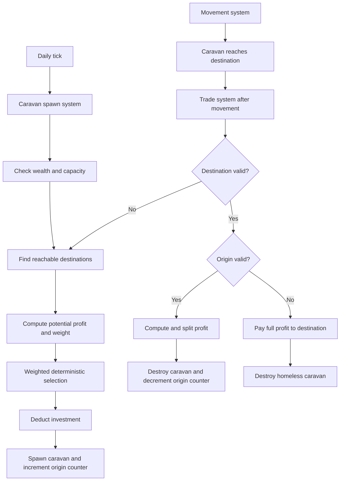

# Basic world economy

Started: 2026-10-18 (renamed from `alpha_wealth_treasury`; absorbs `alpha_settlement_buildings` and `alpha_trade`). Design: `management/design_doc.md`, Alpha > Settlements > Local Wealth & Construction, Upkeep & Economy, Buildings, Trade.

## Scope

- Simulation time: calendar days (N ticks), daily ticks as the unit economy mechanics hook into.
- Local wealth per settlement (sources: land output, buildings, caravans), base cost per population, taxation into the owner's single treasury, treasury spending hooks. HUD display and tax control.
- Settlement buildings: definitions (effect, ticks, cost, max level) and in-settlement construction on top of the worker / work type system from `road_construction_2026-10-03.md`. Timed and financed from local wealth (no wealth = suspended). Housing (pop cap) first. Roads are instant and free today, buildings are timed and paid.
- Trade (land and sea): road network graph, caravan spawn (pop, wealth, upgrades), weighted random target selection, wealth generated at stops for home and visited settlement, caravanserai cap. Sea trade lanes included.

## Order

1. Time system (calendar days). 
2. Wealth / treasury.
3. Buildings.
4. Trade.

## Tasks

1. Time system:
   - [DONE] Survey of tick-based timing.
   - [DONE] `TICKS_PER_DAY` + `world_is_daily_tick` in `world_sim.h`; growth moved to daily tick, amounts x2; stale comments fixed. Untested: needs build + growth pace check.
2. Wealth / treasury:
   - a. Population accounting refactor (peasants / soldiers home / soldiers raised, `settlement_population`). Coded incl. casualties mirrored to home settlement (`world_army_take_casualties`) and pool growth +2/day. Untested: needs build + hand checks (raise, disband, pool growth, display, siege, battle casualties).
   - b. [DONE, untested] Daily economy tick: base land output, effective output, wealth, tax, consumption, growth. Per-player `world.player_states[player]` (`world_player_state`: treasury, income, expenses, net_change; GDO below the struct; deposit-only treasury), `tax_rates` signed, `settlement_finances`; GDO: `base_land_output`, `local_wealth`, `tax_rate`, `finance_*`. Territory `pressure` kept (used by expansion). To check: spawn starvation (500 peasants vs one tile), stockpile behavior.
   - c. [DONE, untested] Set-tax command `SET_SETTLEMENT_TAX_RATE {settlement, tax_rate}`: owner only, within `tax_rate_min` 0 / `tax_rate_max` 10 (game parameters; negative = future investment). Slider next to local wealth in the settlement inspector, negative blue / positive yellow, owned only.
   - d. [DONE, untested] UI: treasury readout, calendar, wealth / population rows (see task B notes).
3. Buildings (on workers; see Buildings design + decisions):
   - a. [DONE] Settlement building data: building type table (rows with optional events) in `world_entities.h` next to per-settlement counts; `troop_max` / `troop_training` in `settlement_population` + GDO; per-mille params and `troop_growth_per_day` removed; daily building tick as own system; Barracks handlers, training and max hand-tested OK. Housing row dropped on purpose; per-building-type GDO lines wait on dynamic GDO properties.
   - b. Settlement construction worker (in-settlement, `BUILD_SETTLEMENT_BUILDING`, data = building type): command, daily financing, stall, job accounting. [DONE, untested] `BUILD_SETTLEMENT_BUILDING` command, `workers` in `settlement_population` (counts in consumption / growth, not land output), `settlement_wealth_fund_from_treasury`. Worker system now runs after the settlement buildings daily tick (was first). No UI; test via console `send_command`.
   - c. Found-settlement worker (on-map, `FOUND_SETTLEMENT`, data = target location + colonist count): moves to the spot, founds a village, else returns home and rejoins the population. [DONE, untested] Command `FOUND_SETTLEMENT {settlement, target}` replaces the army-based one; colonists (150, game parameter) leave population on spawn; workers have `positions` / `movements`, drawn as squares; attack-on-worker not built (hook: `world_resolve_attack`). No UI; test via console.
   - d. [WIP, peer] Client UI: bigger inspection panel over the old action bar, action bar becomes bottom-right action panel (RTS style), "Construction" action switches the inspection panel to the settlement's constructions (levels / counts + ongoing projects). Not started.
4. Trade: not broken down yet.

## Decisions

- Calendar day = fixed number of ticks. Mechanics are specified in days and run on a daily tick, not raw tick counts.
- Day length 100 ticks (5 s at current rate). Days only; larger units (months / years) later if needed.
- Pop and troop-pool growth move to the daily tick: same tick for all settlements (no guid stagger), same per-second rate (per-run amounts doubled).
- Battle round (20 ticks) and per-tick systems (raising draw, territory, construction, movement) stay tick-based for now.
- Tax rate: per-settlement number, stored on the settlement, resets to 0 (neutral) on change of owner. 0 = none, 100 = all wealth taxed on the next daily tick. Gameplay limit (~10) is a later input / UX matter. Player-set via command.
- Investment = negative tax rate: gifts that % of the treasury to the settlement each day. Not now, but the rate must be stored signed (range -100..100).
- Local troops == pool troops (upkeep from local wealth).
- Population accounting per settlement (struct, like army troops): peasants + soldiers per type, soldiers split between at home and in armies (raised). Levies: no home pool, only counted while in armies. Levies in the field count in the settlement population (as soldiers, not at home).
- Peasants = everyone at home who is not a soldier. Raising: peasants -> soldiers (settlement side) + levies in the army. Troop pools are trained from peasants (1 peasant -> 1 soldier of a type).
- Disband: levies -> peasants; other types rejoin the local troops (raised count of each type goes down by the army's amount).
- Population shrink: total deaths computed, then split peasants / soldiers. For now peasants only. Later: soldier share of deaths (a %), spread over home soldiers, ordered by type (knights last).
- Siege defense left as is for now (to revisit with military mechanics); only minimally adapted to compile with the new struct.
- Growth counts population at home (peasants + home soldiers) and creates new peasants.
- Land output becomes base land output = peasants that can work the land at full efficiency. Effective output = base + surplus / (1 + surplus / base), where surplus = max(0, peasants - base); below base it is just peasants (min()).
- Daily order: (1) output: effective output -> wealth via a small function (1 wealth per unit now; multipliers / bonuses later), added to local wealth; (2) tax % of local wealth moves to treasury; (3) consumption: base consumption = f(total population at home) is deducted from local wealth; (4) growth from how well consumption was met.
- No target population anymore: growth depends only on consumption vs current population.
- Growth rule (r = wealth available / required consumption): enough: +2%, plus up to +2% more scaled by excess / consumption (capped at excess == consumption; excess is not consumed). Shortfall: growth goes from the enough-level down to 0% at 10% under required; then shrinks, reaching -20% at 50% of required; no worse below that.
- Every transaction to / from local wealth and treasury must be individually determinable (clients need an accurate breakdown). Likely a financial state / ledger object; not designed yet.
- Growth curve: r >= 1 -> +2% (+ up to +2% by excess / consumption), 0% at r = 0.9, -20% at r = 0.5 and below; linear between. "Available" = whole local wealth after tax, stockpile included. No food vs wealth distinction for now.
- Consumption: 1 wealth per person at home per day. Small-population percentages get sensible minimums (min +1 when growing, min -1 when shrinking).
- Financial breakdown: per-settlement struct of last day's figures (income, tax, consumption, excess, growth rate) written by the daily tick, exposed via GDO.
- Battle casualties: deducted from the army AND from the home settlement (raised counts and total), freeing room in pools / peasants.
- Single-production / needs-consumption model (food vs commercial wealth) deferred; revisit with buildings / trade.
- Day-length constant lives in the main world_sim header, with a helper telling whether the world is currently on a daily tick.
- Sea trade stays in Alpha: only the definition of links between settlements and the pathing differ from land.
- Caravans travel only on roads (land) / established lanes (sea).

## Open questions

- Buildings (see Buildings design): knights cap before Keep, free starting Barracks, project queue, recruitment rate, split into own unit file.
- Upkeep split for armies (treasury): see `alpha_troops_recruitment`.
- Caravan return trip, or disappear at target?
- What does a caravan carry (plunder gives "carried gold")?
- How are sea lanes established?

## Buildings design (proposed, awaiting user answers)

Direction (user, 2026-10-21): settlement construction runs on worker entities (formerly builders; generalized to bounded-life civilian processes, design grows from real uses, no own work unit), plus a settlement-specific upgrades / buildings mechanic. First application: local troops max and training rates. The "project slot / daily tick pays cost" mechanics below are superseded where workers cover them.

- First building: Barracks (3 of the doc: 5 days, 500 wealth, +10 men-at-arms and +5 horsemen capacity per level). Goal is a general building system; mechanics iterate later. Housing deferred (pop cap meaning unclear in the consumption model).
- Definitions: constexpr table in `game_parameters` (build days, cost, max level, effect params).
- Settlement state: level per building type + one construction project slot (type, days done); GDO.
- Financing: daily tick pays cost / days from local wealth and advances one day; short on wealth = suspended.
- Command `BUILD_BUILDING {settlement, building_type}`: owner only, no running project, below max level.
- Troop caps: `settlement_troop_max` = levels x capacity per type; per-mille parameters removed; levy max stays peasants - 10.
- UI: Buildings section in the inspector (levels, project progress row) + Build actions in the settlement action bar.
- Answers (user, 2026-10-21): knights cap 0 until a Keep exists (yes); no free starting Barracks (maybe some levies raisable immediately / uncapped, irrelevant for now); no project queue: any number of constructions in parallel as long as they do not conflict (two upgrades of the same building cannot run in parallel; new instances of a building can). Every active construction costs per day; short on manpower / resources = stalls. Barracks sets troop max and training rates; values are placeholders. No separate unit file.
- Supersedes above: "one construction project slot" and "level per building type".
- Building storage: every building type is a per-settlement "settlement building" entry with level / count starting at 0. Two kinds: unique (upgraded to a max level: keep, walls, trade center) and multiplied (count grows: housing, barracks, storage). Alpha scope now: multiplied only (barracks, housing). No on-map buildings for now (outside roads).
- Construction manpower: a financed project is a "job" that takes workers out of the peasant pool for as long as it is financed. They still count as settlement population (consumption, growth) exactly like peasants. Financing: money moves treasury -> local wealth as the workers are paid. Open: fixed wealth / day per project vs a player slider.
- Financing: fixed wealth / day per project (from the definition), treasury -> local wealth as workers are paid; cost multipliers later. Unfinanced = stalls, workers return to peasants. Project workers leave base land output but count in consumption / growth. Population categories for Alpha: peasants, workers, soldiers (general job system later maybe).
- No generic start-project command: two concrete operations, found settlement (on-map worker) and settlement construction (in-settlement worker). Shared only: worker entity + work type, separate logic in the worker update system (`world_system_worker_construction`).
- Parallel rule: several Building units of a type can be built in parallel; Upgrades of one unique building cannot.
- Colonists of a founding worker leave the population entirely while out (maybe generalize "raised" to "on the field" later). Worker destroyed when attacked.
- Working rule (user): no game-design concerns until said so; temporary broken mechanics are fine; major systems first.

## Peer brief (task 3d)

- Goal: RTS-style client UI, designed with the user. Inspection panel much bigger, placed over where the action bar is now, so mode changes are evident. Action bar becomes an action panel, bottom right. A "Construction" action on a selected owned settlement switches the inspection panel to that settlement's constructions: building counts (current level / count per type) + ongoing projects (worker, progress) + a way to start a `BUILD_SETTLEMENT_BUILDING` (barracks for now).
- Also in scope if small: UI to start `FOUND_SETTLEMENT {settlement, target}` (pick owned settlement + target tile; preview validity with `client_command_query_valid`, mirror `DESTINATION_INVALID` in `input.ts` feedback enums). Ask the user.
- Server-side gaps the UI needs (ask the user before doing): per-building-type counts not in GDO (waits on dynamic GDO properties); worker progress not in GDO (idea: common progress value or getter).
- Imprints: chain for `src/platform/web_game_client/front/src` (+ ui/inspection, modes), root `front_src.imprint.md` mode tree; notes in `src/game_common/world_sim/.ai_imprint/`.
- Decisions: see Decisions above (workers, buildings, parallel projects, found settlement). UI wishes section below (generic panel design, genericity, no hint element) still holds. No game-design concerns; values are placeholders.
- Open: panel layout/sizes, how project list is fed to the client, dynamic GDO properties.
- Done: user hand-tests in browser.

## Current state

- Wealth, treasury, tax, consumption-based growth, per-player state, calendar and player panel exist (see Next step). Cost hooks `raise_army_can_afford` / `raise_army_charge` are still stubs (match_commands.cpp). Validity error flags mirrored by hand in input.ts.

## Depends on

`straight_line_movement_2026-10-15.md` (trade).

## Next step

State: time system, accounting, daily tick, game parameters, inspection feature, tax command, player state panel (incl. `settlement_count`, `total_population`, `total_troops`), ceiling change, entity helpers + `world_update_player_stats`: all coded. First batch hand-tested OK; untested since: ceiling change (quirk: slider range 0..max, marker can pass the end if home + raised > max), GDO buffer fix (384 -> 1024; command GDO buffer is 128 bytes, largest command 82), `world_player_state` income / deficit, entity helpers (`world_sim_army.h` / `world_sim_settlement.h`, `TROOP_TYPE_*`; player stats lag one tick; disband returns exactly the released amount).

Decided: army gauges show current vs raised count as max; `GAME_PARAMETERS` stays where it is; ceiling targets home + raised (training room = min(ceiling, max) - (home + raised); lowering discards only home troops down to ceiling - raised; `ceiling_*` GDO = effective total ceiling); enemy info visible in inspection panels; remaining constants sweep (territory, battle, movement, army reach, terrain) happens with the systems they belong to; all mutations of population / troops / owner go through the entity helpers.

Housekeeping for the user: delete stale compiled .js in web/src (ui/ui_element_treasury.js, troop_gauges.js, ui_element_hint.js, ui_element_properties_panel.js, mode_hint_ui.js, settlement_bar_ui.js). Imprints that could mention `game_parameters.h`, `world_player_state`, `ui/inspection/` (user's call).

Side task (client-only, user bonus 2026-10-21): road rendering as drawn shapes from the 8-neighbour road mask, same style / color as the path preview; coded in render.ts (`draw_roads`), untested. Roads now controlled only by `show_infrastructure` (not `show_territory`). Road flag change not planned. Settlements now set `is_road` on their tile at spawn (world_sim_settlement.cpp), untested; destroy leaves the road; client road origin check in `road_building.ts` now uses server validity feedback (`get_command_feedback("BUILD_ROAD", ...)`, `ORIGIN_INVALID`, right-hand neighbour as stand-in destination); coded, untested.

Next: user hand-tests the untested items; answers the Buildings design questions; then a builder does the first building task (table, settlement state + GDO, new troop-cap rule). After: `straight_line_movement`, then trade. Smaller candidates: war economy costs / upkeep (`alpha_troops_recruitment`), replacement for found settlement.

## UI wishes (user, 2026-10-20)

- Generic panel design (experimental, must be tidy and easy to remove / replace): panel = title + ordered rows; row types are reusable elements (gauge, value row with delta + optional hover breakdown, text row); per-entity-type inspector functions compose shared section builders (troops, population, wealth); one generic tooltip element. Order: A (container + inspectors, no visible change), B (value row, tooltip, wealth / population sections), C (treasury HUD, needs client query of per-player state).
- Every selected entity gets the panel (enemy / other types included). Actions are simply not shown in the modal code when the selected entity is not owned (not a universal rule).
- Hint element removed (tutorial / tooltips later). Done inside task A.
- Calendar at the top of the screen: current day + time left until the next daily tick. Needs a client-readable global world state (age, TICKS_PER_DAY); share the mechanism with the treasury readout (task C).
- Global game parameters: one constexpr static structure holding every global constant of the world sim (ticks per day, rates, thresholds, magic numbers), exposed to the client through the backend, with a GDO for easy reading. World state values (age, treasury) are exposed property by property.
- Legacy debug text panel stays; add a way to collapse / hide it (click and/or hotkey).

- Genericity pass first: the entity inspection panel must show any entity type, not just armies / settlements with troop breakdowns. Complex in-panel elements reusable across panels; panels (except special ones like the action panel) generic and able to hold anything. No two different panel elements per inspected entity type (settlements and armies share elements). Multi-file client change.
- Treasury gold count always visible, bottom left (position may change).
- Settlement inspection panel: local wealth with last day's change beside it; hover shows a floating breakdown window.
- Population count with growth / shrink next to it.


## TEMP: Implementation plan for caravans / trading

## Implementation Plan: Settlement Trading and Caravan Simulation

### Problem Statement

Reintroduce caravans and settlement trade into the deterministic world simulation. Settlements will invest local wealth into caravans, caravans will select reachable destinations, travel using existing pathing, and complete one trade transaction on arrival. Trade value and profit must remain exposed through centralized game parameters so the formula can be tuned and eventually reused for client-side prediction.

### Requirements

- Spawn caravans once per daily tick.
- Each settlement rolls independently once for every missing caravan slot.
- Spawn probability:
  - One missing slot: 25%.
  - Five or more missing slots: 75%.
  - Intermediate values scale between those bounds.
- Do not spawn if:
  - The settlement has reached its caravan maximum.
  - The settlement has less than the configurable minimum local wealth.
  - The settlement has no valid destination.
  - The settlement cannot fund the caravan.
- Caravan investment equals 10% of the origin settlement’s accumulated local wealth.
- The minimum wealth threshold is a game parameter, initially `100`.
- The investment is removed from origin local wealth when the caravan spawns.
- Caravans disappear when they reach their destination.
- No intermediate stops.
- No ship or sea-trade behavior in this phase.
- Destination selection considers every valid settlement on the map.
- A destination must have a valid path from the origin.
- Destination selection is deterministic weighted random selection.
- Selection weight is based on potential profit divided by travel distance.
- Invalid destinations are retargeted:
  - If the destination is invalid, choose another destination using the same selection logic.
  - If the origin is still valid, use the origin as the source for the new selection.
  - If the origin is also invalid, select using the caravan’s current location.
- If the origin is destroyed after spawning:
  - The caravan continues normally.
  - It becomes homeless.
  - The destination receives the entire profit.
- When a caravan reaches its destination:
  - Compute profit.
  - Split profit equally between origin and destination when the origin remains valid.
  - Give all profit to the destination when the origin is invalid.
  - Destroy the caravan.
  - Maintain settlement caravan counters transactionally.
- Base profit is `caravan_value * 2`.
- Additional profit depends on:
  - Caravan value relative to destination local wealth.
  - Travel distance.
- Distance uses total path travel cost, not travel time.
- The distance bonus follows a logarithmic curve:
  - It rises quickly up to approximately one region.
  - It rises more slowly afterward.
  - It plateaus near three regions for land caravans.
  - Ship tuning is reserved for later.
- The profit calculation must be a standalone callable function with all relevant inputs.
- Trade parameters should be grouped in a dedicated substructure inside `game_parameters`.
- Trade parameters and the resulting function must be easy to expose to clients later.
- Trade processing runs in a dedicated system after movement.
- No external research is required. Existing repository conventions and APIs are the source of truth.

### Repository Findings

- `world_entity_settlements` already contains `settlement_trading` with active and maximum caravan counts.
- `world_entity_caravans` already stores:
  - Location
  - Movement state
  - Origin settlement
  - Destination settlement
  - Caravan value
  - Ship flags reserved for later
- `world_spawn_entity_caravan` and `world_destroy_entity_caravan` exist but do not currently maintain settlement counters.
- Caravan allocation does not currently initialize all container metadata and arrays consistently.
- `world_state_tick` already separates movement from later systems and can host:
  1. Daily caravan spawning.
  2. Movement.
  3. Trade arrival and retarget processing.
- `world_request_path` returns both path existence and total path length/cost.
- The world uses a deterministic `rand_generator_32` stored in `match_world_state`.
- Global simulation parameters belong in `include/game_common/match/game_parameters.h`.
- The current daily economy resets settlement financial figures, so caravan investment and trade profit need an explicit accounting decision within the trade flow.
- Settlement destruction currently only invalidates the settlement slot. Caravan references must therefore be validated every time they are used.

### Proposed Architecture



The implementation should keep the formula pure and separate from world mutation:

```text
trade_profit(caravan_value,
             destination_local_wealth,
             travel_distance,
             trade_parameters)
```

The destination-selection code can call the same function to calculate candidate weights. The transaction system can call it again using the stored origin-to-destination travel cost.

### Formula Design Assumption

The exact constants are intentionally tunable. The initial implementation should represent the requested shape with integer-safe arithmetic:

```text
value_profit =
    caravan_value
    * destination_local_wealth
    / caravan_value
    * value_profit_per_ten_percent

distance_bonus =
    logarithmic_bonus(travel_distance,
                      land_distance_plateau)

profit =
    caravan_value * 2
    + value_profit * distance_bonus
```

Because `caravan_value * destination_local_wealth / caravan_value` simplifies and loses the intended relationship if evaluated directly, the implementation should instead encode the wealth comparison as a bounded ratio. The plan assumes the intended behavior is:

- A caravan receives a stronger value-based bonus when its investment is small relative to destination wealth.
- The value-based bonus weakens as caravan value approaches or exceeds destination wealth.
- The distance component increases profit according to a configurable saturating curve.
- All intermediate arithmetic uses sufficiently wide integer types before converting to the stored `ui16` caravan value or settlement wealth type.

The exact parameter names and integer scaling should be finalized while implementing the first formula task.

## Task Breakdown

### Task 1: Complete caravan storage initialization and pure trade parameter definitions

**Objective:** Make caravan state safe to allocate and add a centralized, client-readable trade parameter structure.

**Implementation guidance:**

- Update `game_parameters` with a dedicated trade substructure containing:
  - Minimum local wealth required to spawn.
  - Caravan investment percentage.
  - Spawn probability at one missing slot.
  - Spawn probability cap.
  - Missing-slot count at which the cap applies.
  - Base profit multiplier.
  - Value-profit scaling constants.
  - Distance-curve constants.
  - Integer scaling factors and overflow-safe limits as needed.
- Add the corresponding GDO properties.
- Initialize caravan container metadata and arrays consistently:
  - `max_count`
  - `active_count`
  - GUID storage
  - Any state arrays that must start zeroed.
- Keep ship-related parameters out of active behavior, but preserve the existing flag for future work.

**Tests:**

- Verify zero-initialized caravan state has no active caravans.
- Verify the trade parameter GDO exposes the new values.
- Verify caravan allocation reports the requested capacity.

**Demo:** A newly initialized world reports zero active caravans, valid caravan capacity, and all trade tuning values through the game-parameter inspection path.

---

### Task 2: Implement the standalone predicted-profit calculation

**Objective:** Create one pure function that calculates trade profit from caravan value, destination wealth, path distance, and trade parameters.

**Implementation guidance:**

- Place the function in the caravan/trade implementation area or a shared caravan header if clients and multiple systems need it.
- Accept every relevant input explicitly.
- Use deterministic integer arithmetic compatible with the freestanding common code.
- Separate internal helpers for:
  - Value-versus-destination-wealth scaling.
  - Saturating logarithmic distance bonus.
  - Overflow-safe multiplication and division.
- Make the distance plateau configurable rather than embedding the three-region behavior in the function.
- Return a wide enough type for intermediate and final profit calculations.
- Define behavior for:
  - Zero caravan value.
  - Zero destination wealth.
  - Zero distance.
  - Extremely large wealth or path costs.

**Tests:**

- Base profit is present for a caravan with no bonus.
- A smaller caravan relative to destination wealth receives a larger value-based bonus.
- Distance bonus rises quickly at short distances and flattens at long distances.
- Increasing distance never decreases the distance bonus.
- Zero and maximum input values do not divide by zero or overflow.
- The function is deterministic and has no world-state side effects.

**Demo:** A diagnostic caller can calculate predicted profit for several caravan values, destination wealth values, and path costs without spawning entities or mutating the world.

---

### Task 3: Add path-aware destination candidate evaluation and weighted selection

**Objective:** Select a valid destination from all active settlements using deterministic weighted random choice.

**Implementation guidance:**

- Enumerate active settlements.
- Exclude:
  - The origin settlement itself.
  - Invalid or empty settlement slots.
  - Settlements with no valid path.
- Request a path from the source location to each candidate.
- Use the returned total path cost as travel distance.
- Calculate potential profit with the standalone profit function.
- Calculate candidate weight from potential profit divided by distance, with explicit handling for zero distance and zero profit.
- Use wide integer accumulators for total weight.
- Select using `world.rand_gen`.
- Return both:
  - Destination settlement GUID.
  - Path distance/cost used for the calculation.
- Support a source location that is either:
  - The origin settlement location.
  - The caravan’s current location when the origin is invalid.
- Keep the selection function separate from spawning and retargeting so it can be reused.

**Tests:**

- Invalid and unreachable settlements are excluded.
- The origin is excluded from its own candidate list.
- No candidate produces a clean “no destination” result.
- Selection is deterministic for the same world state and random seed.
- Candidate weights reflect potential profit divided by path cost.
- A changed road layout can change path cost and therefore selection weight.

**Demo:** A settlement with multiple reachable candidates selects one deterministically, and changing road construction changes the candidate weights without changing the trade formula.

---

### Task 4: Implement transactional caravan spawning and daily spawn rolls

**Objective:** Spawn caravans daily according to capacity, probability, wealth, and investment rules.

**Implementation guidance:**

- Add a daily caravan spawning system.
- Run it only on daily ticks.
- For every active settlement:
  - Calculate missing caravan slots.
  - Perform one roll for each missing slot.
  - Use 25% for one missing slot.
  - Scale toward 75% when five or more slots are missing.
  - Skip the roll’s spawn result when local wealth is below the configurable minimum.
  - Select a destination before modifying wealth.
  - Deduct 10% of accumulated local wealth as the caravan investment.
  - Reject or skip if the resulting investment is zero.
- Store:
  - Origin settlement GUID.
  - Destination settlement GUID.
  - Caravan value.
  - Initial location.
  - Movement destination.
  - Path state.
- Increment the origin settlement’s caravan count in the same operation as successful spawn.
- Ensure the count cannot exceed its maximum.
- Use the existing world RNG so all hosts remain synchronized.

**Tests:**

- No spawn occurs below the minimum wealth parameter.
- Investment equals the configured percentage of local wealth.
- Investment is deducted exactly once.
- Spawn probability scales correctly for one through five missing slots.
- Multiple missing slots result in independent rolls.
- Caravan count increments transactionally.
- A failed destination search does not deduct wealth or increment counters.
- Spawned caravans begin at the origin location with the selected destination.

**Demo:** On a daily tick, an eligible settlement can produce a caravan, local wealth decreases by the investment, and the settlement inspector shows one additional active caravan.

---

### Task 5: Integrate caravan movement with destination pathing

**Objective:** Make spawned caravans follow existing movement and pathing behavior until they reach their selected destination.

**Implementation guidance:**

- Add caravan movement decisions to the existing movement-decision system or a dedicated caravan decision function.
- Initialize movement with the caravan’s origin location and selected destination.
- Use the existing land path parameters.
- Do not implement ship movement or water routes.
- Ensure a caravan with no valid path does not become permanently stuck without a retarget opportunity.
- Preserve the stored destination GUID so arrival processing can validate it.
- Track or recompute the path cost needed by the profit calculation. Avoid relying on travel time.

**Tests:**

- A caravan follows a valid road/path toward its destination.
- A caravan reaches the exact destination tile.
- An unreachable destination does not cause invalid movement state.
- Road changes can affect newly calculated paths.
- Caravans remain deterministic under repeated simulation.

**Demo:** A spawned caravan visibly travels from one settlement to another and stops at the destination tile.

---

### Task 6: Implement destination invalidation and retargeting

**Objective:** Retarget caravans when their destination becomes invalid while preserving the origin and investment rules.

**Implementation guidance:**

- Add a trade-system pass over active caravans.
- Validate the destination before processing arrival.
- If the destination is invalid:
  - Use the valid origin settlement location as the new source when available.
  - Otherwise use the caravan’s current location.
  - Select a new destination using the same weighted candidate logic.
  - Update destination and movement state.
  - Preserve caravan value.
- If no valid destination exists, define a non-destructive fallback that keeps the caravan active and retries later rather than losing investment.
- Do not decrement the origin caravan count during retargeting.

**Tests:**

- Destroying a destination causes deterministic retargeting.
- Retargeting does not change caravan value.
- A valid origin is preferred as the selection source.
- A destroyed origin causes selection from the caravan’s current location.
- No candidate leaves the caravan safely waiting for a later retry.
- Counters remain unchanged during retargeting.

**Demo:** Destroying a caravan’s destination causes it to select and travel toward another settlement without losing its investment.

---

### Task 7: Implement arrival transactions and homeless-caravan handling

**Objective:** Complete trade when a caravan reaches its destination and maintain all wealth and entity counters transactionally.

**Implementation guidance:**

- Run the trade system after movement in `world_state_tick`.
- Iterate over caravans and process only those whose current location has reached the destination settlement location.
- Revalidate both destination and origin.
- Recompute or use the stored origin-to-destination path cost for the profit function.
- Compute total profit through the standalone function.
- If origin is valid:
  - Add half the profit to origin local wealth.
  - Add the remainder to destination local wealth.
  - Decrement origin caravan count.
- If origin is invalid:
  - Add all profit to destination local wealth.
  - Do not attempt to decrement a destroyed settlement.
- Destroy the caravan after the transaction.
- Make sure settlement wealth arithmetic cannot wrap.
- Decide whether trade income should appear in `settlement_finances` immediately or whether a separate trade result field is needed. The initial plan should use a dedicated trade-result field if clients need the transaction breakdown without overwriting the daily land-economy figures.

**Tests:**

- Arrival destroys the caravan.
- Origin and destination each receive half of the profit.
- A homeless caravan gives all profit to the destination.
- Origin caravan count decrements exactly once.
- Invalid origin does not cause a stale-memory access.
- Invalid destination is retargeted instead of transacted.
- Profit calculation receives the correct caravan value, destination wealth, and distance.
- Wealth changes are deterministic and overflow-safe.

**Demo:** A caravan reaches a settlement, disappears, and the expected wealth appears in the origin and destination settlement state.

---

### Task 8: Wire systems into the world tick and expose trade state

**Objective:** Integrate spawning, movement, retargeting, arrival, and client-readable state into the complete simulation.

**Implementation guidance:**

- Add declarations to `world_sim.h`.
- Add the appropriate caravan/trade source files to `world_sim_main.cpp`.
- Place systems in this order:
  1. Daily caravan spawning with the daily economy systems.
  2. Existing movement decision and movement systems.
  3. Caravan trade processing after movement.
- Preserve existing system ordering unless a specific dependency requires otherwise.
- Expose any last-trade fields needed by clients, such as:
  - Last trade profit.
  - Last trade income.
  - Last caravan investment.
  - Last trade distance.
- Keep the formula callable independently for future client prediction.
- Update the relevant management work-unit documentation only if documentation changes are included in the eventual implementation scope. Imprint files remain untouched.

**Tests:**

- A complete daily cycle can spawn, move, and eventually complete a caravan trade.
- Daily spawning does not run on non-daily ticks.
- Arrival processing runs after movement.
- Settlement and caravan queries expose consistent counters and values.
- Replaying the same seed and commands produces the same caravan and wealth results.
- Existing economy, building, movement, and settlement tests remain unaffected.

**Demo:** A complete simulation shows a settlement funding a caravan, the caravan traveling along a path, destination arrival, profit distribution, caravan removal, and correct active-caravan counters.

### Open Implementation Assumptions

- The 25% to 75% spawn chance is scaled linearly by missing slots and capped at five missing slots.
- A caravan with zero computed value is not spawned.
- A caravan’s value remains fixed throughout its journey.
- Profit is computed from the origin-to-destination path cost, not the caravan’s actual elapsed travel route.
- If a destination becomes invalid after the caravan reaches its former destination tile, the caravan retargets rather than transacting.
- If no destination is currently reachable, the caravan remains active and retries later.
- Trade wealth is added to settlement local wealth immediately when the arrival transaction runs.
- Ship support remains deferred, but the parameter structure should allow separate land and ship distance plateau values later.

Does this plan look good, or would you like me to adjust anything?
